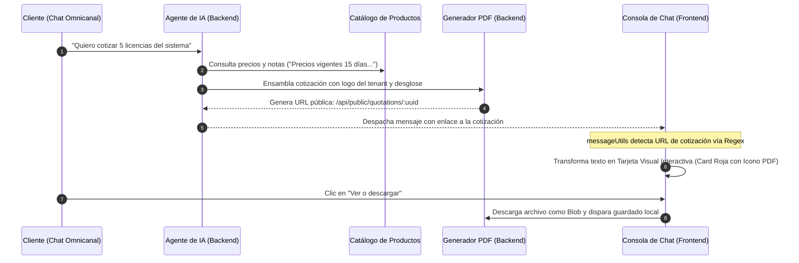

# 📦 CRM TIBS — Cotizaciones PDF & Módulo de Productos

Este documento detalla la estructura del **Catálogo de Productos y Servicios**, la integración de directivas de cotización para el **Agente de IA**, el motor de generación de documentos PDF mediante **jsPDF** ([`jspdf`](file:///c:/Users/sopor/Proyectos/CRM/crm-tibs-app/package.json)) y la detección reactiva de tarjetas descargables de cotización en el feed del chat ([`messageUtils.tsx`](file:///c:/Users/sopor/Proyectos/CRM/crm-tibs-app/src/utils/messageUtils.tsx)).

---

## 📄 Flujo de Cotización Automática y Descarga PDF



---

## 🏷️ 1. Módulo de Productos y Notas para el Agente de IA

El catálogo comercial opera a través del formulario reactivo [`ProductForm.tsx`](file:///c:/Users/sopor/Proyectos/CRM/crm-tibs-app/src/components/Product/ProductForm.tsx) y la vista tabular homologada [`ProductsTable.tsx`](file:///c:/Users/sopor/Proyectos/CRM/crm-tibs-app/src/components/Product/ProductsTable.tsx) sobre el componente compartido `Table` (variante `cards`), integrando ordenamiento por código, precio o nombre, previsualización de imágenes de portada y control de estado (activo/inactivo). Cada producto o servicio registra:
* **Datos Comerciales:** Nombre, código SKU, precio base, moneda (MXN/USD) y descripción detallada.
* **Archivos Adjuntos (`ProductFilesTab.tsx`):** Fichas técnicas, catálogos en PDF y hojas de especificaciones.
* **Notas Libres para el Agente de IA:** Campo de texto libre donde los administradores definen reglas de negociación (e.g. *"Si el cliente solicita más de 10 unidades, ofrecer 10% de descuento; tiempo de entrega 3 días hábiles"*). El bot de IA lee estas notas al vuelo durante las conversaciones en vivo.

---

## 🔍 2. Detección Inteligente de Enlaces PDF en Mensajes

Para evitar que los usuarios y clientes vean enlaces crudos e inamistosos, [`src/utils/messageUtils.tsx`](file:///c:/Users/sopor/Proyectos/CRM/crm-tibs-app/src/utils/messageUtils.tsx) analiza el texto entrante mediante expresiones regulares:

```typescript
const pdfMatch = content.match(
  /(https?:\/\/[^\s\)\]"]+\.pdf|https?:\/\/[^\s\)\]"]*\/api\/public\/quotations\/[a-f0-9\-]{36}|\/api\/public\/quotations\/[a-f0-9\-]{36}|\/uploads\/[^\s\)\]"]+\.pdf|uploads\/[^\s\)\]"]+\.pdf)/i
);
```

### Renderizado de Tarjeta Interactiva:
Cuando la expresión regular encuentra una coincidencia:
1. Extrae la URL absoluta hacia el documento.
2. Renderiza una tarjeta estilizada con fondo blanco translúcido (`bg-white/20`), icono `FileText` de Lucide sobre un contenedor rojo y texto *"Cotización en PDF — Ver o descargar"*.
3. **Descarga Segura en Blobs:** Al hacer clic, ejecuta una llamada `fetch(fullUrl)` convirtiendo la respuesta en un `Blob` temporal (`window.URL.createObjectURL(blob)`), garantizando la descarga inmediata en el dispositivo del cliente.

---

## 📑 3. Motor de Generación de Reportes con jsPDF

El frontend utiliza [`jspdf`](file:///c:/Users/sopor/Proyectos/CRM/crm-tibs-app/package.json) y el plugin [`jspdf-autotable`](file:///c:/Users/sopor/Proyectos/CRM/crm-tibs-app/package.json) en múltiples dominios:
* **Pipeline Comercial ([`usePipeline.ts`](file:///c:/Users/sopor/Proyectos/CRM/crm-tibs-app/src/hooks/usePipeline.ts)):** Exportación tabular de acuerdos, importes, probabilidades de cierre y ejecutivos a cargo.
* **Actividades ([`useActivities.ts`](file:///c:/Users/sopor/Proyectos/CRM/crm-tibs-app/src/hooks/useActivities.ts)):** Resumen cronológico de reuniones y llamadas realizadas por el equipo.
* **Tickets de Soporte ([`useHelpdesk.ts`](file:///c:/Users/sopor/Proyectos/CRM/crm-tibs-app/src/hooks/useHelpdesk.ts)):** Reporte de incidencias por prioridad y días en etapa.
* **Dashboard ([`useDashboard.ts`](file:///Users/eimvi/Documents/GitHub/crm-tibs-app/src/hooks/useDashboard.ts)):** Resumen ejecutivo con métricas de ventas y soporte.

---

## 💸 4. Control de Gastos Corporativos (`src/pages/ExpensesPage.tsx` y `src/components/Expense/`)

El módulo de egresos y fiscalización de gastos operativos permite registrar, categorizar y auditar desembolsos corporativos:

* **Orquestador Principal ([`ExpensesPage.tsx`](file:///c:/Users/sopor/Proyectos/CRM/crm-tibs-app/src/features/expenses/pages/ExpensesPage.tsx)):**
  - Integra la carga de gastos mediante `expensesService.ts`, barra de filtros superiores y modales interactivos.
* **Sanitización Estricta de Payloads (`expensesService.ts` & `ExpenseForm.tsx`):**
  - Sanitización en cliente (`sanitizeExpensePayload`) para cumplir con `forbidNonWhitelisted: true` en el backend NestJS (evitando error 400 Bad Request).
  - Al enviar `POST /api/expenses` o `PATCH /api/expenses/:id`, se descartan metadatos (`id`, `createdAt`, `usuario_id`, `receiptUrl`) y relaciones (`client`, `opportunity`, `usuario`).
  - Solo se transmiten los campos editables: `fecha`, `concepto`, `monto` (como `Number`) y la asociación exclusiva mutua (`client_id` o `opportunity_id`, enviando `null` en el campo opuesto).
* **Selector Dinámico y Formato de Clientes (`formatClientLabel`):**
  - Formateo defensivo que evita concatenaciones con guiones fijos o vacíos (`Jonathan - -`). Agrupa `[nombre, apellido]` y solo agrega paréntesis con `[empresa, puesto]` si contienen datos válidos: `Nombre Completo (Empresa - Puesto)`.
* **Tabla Homologada TanStack ([`ExpensesTable.tsx`](file:///c:/Users/sopor/Proyectos/CRM/crm-tibs-app/src/features/expenses/components/ExpensesTable.tsx)):**
  - Implementada sobre el componente compartido `Table` (`src/components/shared/Table`) con variante `cards`.
  - Columnas estructuradas con `ColumnDef<Expense>`:
    - **Concepto / Descripción:** Detalle del gasto con categoría asociada.
    - **Importe Monetario:** Formateo en divisa con identificador de moneda (`MXN` / `USD`).
    - **Fecha:** Fecha del gasto formateada con soporte de ordenamiento interactivo.
    - **Responsable:** Usuario o ejecutivo que reportó el desembolso.
    - **Asociado A:** Badge contextual de Cliente o Oportunidad con nombre seguro.
    - **Comprobante:** Icono y enlace interactivo para visualizar o descargar la factura / recibo adjunto ([`ReceiptUploadModal.tsx`](file:///c:/Users/sopor/Proyectos/CRM/crm-tibs-app/src/features/expenses/components/ReceiptUploadModal.tsx)).
    - **Acciones:** Menú contextual para edición y confirmación de eliminación segura.
* **Filtros y Formularios:**
  - [`ExpenseFiltersBar.tsx`](file:///c:/Users/sopor/Proyectos/CRM/crm-tibs-app/src/features/expenses/components/ExpenseFiltersBar.tsx): Filtrado por usuario responsable, fecha y buscador reactivo por concepto.
  - [`ExpenseForm.tsx`](file:///c:/Users/sopor/Proyectos/CRM/crm-tibs-app/src/features/expenses/components/ExpenseForm.tsx): Formulario reactivo para alta y actualización limpia de gastos con selector de cliente / oportunidad.

---

## 🔗 Enlaces Relacionados
* [[CRM TIBS APP]] — Hub Maestro.
* [[CRM TIBS - Chat Omnicanal, WebSockets & Agente IA]] — Feed donde se muestran las cotizaciones.
* [[CRM TIBS - Tablero Kanban & Pipeline Comercial]] — Oportunidades asociadas a cotizaciones.
* [[CRM TIBS - Dashboard, Analitica & Reportes]] — Ventas acumuladas de productos y egresos.
